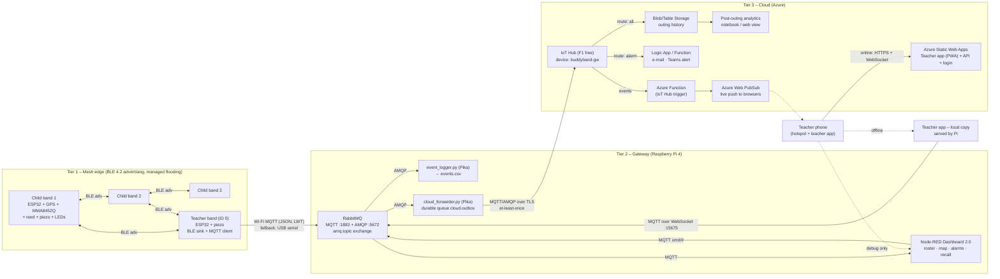

# BuddyBand – Optimized Architecture & Work Plan

Version 1 · 14 Nov 2026 · status: **proposal for the team** (nothing in here changes
`protocol.md` yet – the proposed protocol changes in §4 need WP1+WP2+WP3 sign-off).

Inputs: course lectures L1, L2, L4, L6, L7, L8, IoT-Lab slides, the signed device list of
IOT-BOX 4, and the current repo (`protocol.md`, firmware skeleton, gateway README).

Deadline: **Wed 9 Dec 2026** (code, report ≤ 7 pages, poster, demo). That leaves ~3.5 weeks.

---

## 1. TL;DR – what changes

| # | Change | Why |
| --- | --- | --- |
| 1 | **Cloud is no longer "optional"** – it becomes a small but real tier (Azure IoT Hub + storage + alert) | Final-project requirement explicitly lists *Sensing, Comm, **Cloud**, Data visualization*; course goal is "IoT solutions using major cloud platforms" (L1 p.5, p.7) |
| 2 | **Edge-first split**: all safety logic stays on band + gateway; cloud only gets alarms, stage changes, 1-min summaries, incident GPS | Must work in a forest without internet; also keeps us under the IoT Hub free-tier quota (§5.5) |
| 3 | **Store-and-forward via a durable RabbitMQ queue** on the Pi (`cloud.outbox`) + idempotent cloud writes keyed by `(band, seq)` | Shows L7 (queueing/buffering) and L2 (at-least-once + dedup) on our own data |
| 4 | **GPS armed at stage 1, reported at stage 2** (instead of switched on at stage 2) | Cold start is 30 s+; a fix must already exist when the child becomes critical |
| 5 | **SOS = double-tap** on the MMA8452Q (built-in pulse detection) | The kit has no push button; the accelerometer does this in hardware |
| 6 | **Latched ALARM on isolated bands** (resend every 5 s until ACK), random boot sequence number | Isolated band currently gives up after 5×500 ms; reboot can collide with duplicate cache |
| 7 | **MQTT Last Will** for the teacher band + retained per-band state, per-client RabbitMQ users | L4 (LWT, security); dashboard immediately knows when the teacher band is gone |
| 8 | **Fallback for the teacher band: USB-serial → Pi bridge** if Wi-Fi/BLE coexistence loses too many packets | One radio does BLE scan + Wi-Fi; measured risk, cheap fallback |
| 9 | **Phone hotspot as the single network** (Pi, teacher band, teacher phone join it) | Gives internet for the cloud tier outdoors; Pi-as-AP stays as offline fallback |
| 10 | **Teacher app = one frontend, two deployments**: Azure Static Web Apps (primary) + same build served by the Pi (offline fallback) – see §5.4 | Remote access, HTTPS push notifications and login from the cloud; still works in a forest without internet |

---

## 2. Hardware inventory (IOT-BOX 4) and allocation

| Item (signed list) | Qty | Allocation |
| --- | --- | --- |
| ESP32 DevKit (WROOM-32D) + micro-USB | 2 + 2 (handwritten) = **4** | 3 child bands (ID 1–3) + teacher band (ID 0) |
| Raspberry Pi 4 (#47) + charger + SD | 1 | Gateway. **Do not change the Pi password** (device-list rule) |
| SparkFun MMA8452Q accelerometer (I²C) | 3 | 1 per child band: tamper/fall, SOS double-tap, activity |
| GPS sensor (UART NMEA) | 3 | 1 per child band |
| Magnetic door switch (reed) | 3 | 1 per child band: clasp-open → tamper alarm |
| Piezo speaker | 4 | 3 child bands (recall / alarm beep) + teacher band (alarm) |
| LEDs green/yellow/red | 3 | **teacher band only** (decided 14 Nov): group state green = all complete, yellow = any drifting/critical, red = any isolated |
| Resistor 330 Ω | 3 | LED series resistors (teacher band) |
| Small breadboard | 3 | 1 per child band |
| Wires | 20 + 20 | |

**Gaps to resolve this week**

- **LEDs/resistors:** 3 resistors means either 3 LEDs total or 3 sets with too few resistors.
  Count the box. If it is 3 LEDs total, either buy a bag of 5 mm LEDs + 330 Ω (≈ CHF 5) for a
  traffic light on every band, or give each band one LED with blink patterns.
- **Power:** nothing mobile in the kit. Each band needs a **USB power bank** (team-owned). Pick
  banks that don't auto-switch-off at low current (ESP32 with BLE scan draws ~100 mA, usually fine).
  Battery % is not measurable on the DevKit → STATUS sends `255` (already planned).
- **GPS model:** confirm the exact module (Adafruit Ultimate GPS / PA6H / NEO-6M…). The wiring
  below assumes a 3.3–5 V UART module at 9600 baud with an `EN` pin. Without `EN`, use the
  NMEA standby command (`$PMTK161,0*28` for MediaTek) to save power.
- **Wearable mounting:** breadboard + DevKit + power bank on a wrist is not realistic. For the demo
  use an armband/pouch (or a lanyard) – state that clearly in the report.

### 2.1 Child-band pin map (ESP32 DevKit 38-pin, avoid strapping pins 0/2/5/12/15)

| Function | Part pin | ESP32 GPIO | Notes |
| --- | --- | --- | --- |
| I²C SDA | MMA8452Q SDA | 21 | SparkFun board has pull-ups; address 0x1D |
| I²C SCL | MMA8452Q SCL | 22 | |
| Accel interrupt | MMA8452Q INT1 | 34 | input-only pin, fine for INT (tap / freefall) |
| GPS RX ← TX | GPS TX | 16 (UART2 RX) | 9600 baud NMEA |
| GPS TX → RX | GPS RX | 17 (UART2 TX) | for PMTK config commands |
| GPS power gate | GPS EN | 25 | LOW = off |
| Reed switch | one lead | 27 | `INPUT_PULLUP`, other lead to GND; open clasp = HIGH |
| Piezo | + | 14 | LEDC PWM `tone()`; changed from 26 on 14 Nov (band 2 wired to 14, found by pin scan). GPIO14 may click briefly at boot – harmless |
| Power | VIN / 3V3 / GND | – | sensors on 3V3 |

Teacher band (as wired on board 0, 14 Nov): piezo + on 14, − on GND; LEDs green / yellow / red, anode via
330 Ω on 25 / 26 / 27, cathodes to GND; no other sensors. (25/27 are GPS EN / reed on child bands –
no conflict, the teacher has neither.)

Hardware check: `pio run -e hwtest_band -t upload` / `-e hwtest_teacher` (firmware/src/hwtest) – I²C scan,
MMA8452Q ID, GPS baud + RX/TX auto-detect, reed, piezo, LEDs. First result (14 Nov, board 2): MMA8452Q at
0x1D OK, GPS 9600 baud on GPIO16/17 OK, GPS has no backup battery → every power-on is a cold start
(affects D9; measure TTFF outdoors).

---

## 3. Optimized architecture



### 3.1 Responsibilities per tier

| Concern | Band (edge) | Teacher band | Pi gateway | Cloud |
| --- | --- | --- | --- | --- |
| Neighbour RSSI, median filter | ✅ | ✅ | | |
| Stage 0–2 decision | ✅ (local, instant feedback) | | | |
| Stage 3 (isolation) | ✅ local | ✅ STATUS timeout 8 s | ✅ watchdog if teacher band is offline (LWT) | |
| Relay / ACK / retry | ✅ | ACK origin | | |
| Alarm to teacher (piezo, phone) | | ✅ piezo (always, no network needed) | ✅ teacher app – local copy (offline) | ✅ teacher app – cloud copy + push notification |
| Recall command | executes | floods CMD | ✅ button in dashboard | |
| Raw event log for evaluation | | | ✅ CSV (all messages) | |
| Durable history across outings | | | buffer only | ✅ |
| Notify remote people (school office, 2nd teacher) | | | | ✅ |
| Analytics: false-alarm rate, latency, calibration | | | live counters | ✅ batch |
| Config (thresholds per group) | applies | | pushes via MQTT retained `config` | optional: device-twin desired props |

Rule of thumb for the report: **anything that protects a child in real time runs without
internet; the cloud gets what is useful after the fact or far away.**

---

## 4. Review of the design decisions (protocol.md §2) and proposed changes

| ID | Verdict | Comment / change |
| --- | --- | --- |
| D1 broadcast advertising | ✅ keep | Right choice for BLE 4.2 (classic ESP32 has **no** extended advertising, only one adv set → the queue in §4 of protocol.md is required) |
| D2 1-byte node/group ID | ✅ keep | |
| D3 five message types | ✅ keep, add reasons | Add `reason` 4 = fall (freefall/impact from MMA8452Q). SOS = double-tap |
| D4 managed flooding | ✅ keep, two fixes | (a) start `seq` at a **random value** after boot (`esp_random()`), so a quick reboot is not dropped by the duplicate cache. (b) Measure airtime: 4 nodes × STATUS/2 s × 300 ms slot = 1.2 s per 2 s already → consider **200 ms slots** (RSSI test showed ~every adv event is received) |
| D5 E2E ACK for ALARM/GPS | ⚠️ extend | After 5 failed retries the band **latches** the alarm and re-sends every 5 s until ACKed (otherwise an isolated child's alarm is lost forever when it comes back into range) |
| D6 binary over air, JSON over MQTT | ✅ keep | Add gateway-side `ts` (Pi time) and `gw` fields; teacher band has no RTC |
| D7 isolation by teacher timeout | ✅ keep + gateway watchdog | If the teacher band disappears (LWT fires), the Pi raises `teacher_offline` – otherwise isolation would silently stop being detected |
| D8 serial debug only | ✅ keep, with fallback | If coexistence measurement (open point) shows > 10 % scan loss, the teacher band forwards the same JSON lines over USB to the Pi (`serial_bridge.py` → MQTT). Data path stays identical upstream |
| (new) D9 GPS duty-cycle | change | GPS `EN` high at **stage 1**, GPS packets sent from **stage 2**, `EN` low 60 s after returning to stage 0. Hot fix ready when needed, still off > 90 % of an outing |
| (new) D10 stage logic with hysteresis | add | See §4.1 |
| (new) D11 MQTT QoS / LWT / retained | add | PubSubClient publishes QoS 0 only → reliability comes from TCP + band-level ACK; teacher band publishes only after `publish()` returns true before it sends the BLE ACK. LWT `buddyband/<g>/teacher/online` = `false`, retained. Per-band `state` retained so a freshly opened dashboard is complete |
| (new) D12 security | add | RabbitMQ: no more `admin/admin` for devices – users `teacher-band` (publish `buddyband.<g>.band.#`, subscribe `cmd`), `nodered`, `logger`, `forwarder` with topic permissions. Wi-Fi WPA2. Cloud link TLS + SAS token (IoT Hub requires it). Optional stretch: 4-byte truncated HMAC per packet (17 + 4 = 21 ≤ 24 B budget) against spoofed CMD/ACK |
| (new) D13 privacy | add | GPS leaves the gateway **only during incidents** (stage ≥ 2); cloud retention 30 days; no child names on bands or in cloud, only node IDs (mapping lives on the teacher's phone/dashboard) |
| (new) D14 Kafka not used | document | Course covers Kafka (L1/L2), but our rate is ~2 msg/s; Kafka targets high-velocity ingestion (L4 p.6). RabbitMQ gives us MQTT *and* AMQP with one broker on a Pi. Good point for the oral exam |

### 4.1 Stage logic proposal (WP1, thresholds from calibration)

Per neighbour `n` (keyed by `tx`): median RSSI over last 10 samples `m(n)`, `last_seen(n)`.

| Stage | Enter when (held for dwell time) | Dwell | Leave to lower stage when |
| --- | --- | --- | --- |
| 0 complete | ≥ 1 neighbour with `m ≥ T_near` | – | – |
| 1 drifting | no neighbour `≥ T_near`, ≥ 1 with `m ≥ T_far` | 5 s | ≥ 1 neighbour `≥ T_near + 3 dB` for 3 s |
| 2 critical | no neighbour `≥ T_far`, but something heard in last 4 s | 5 s | ≥ 1 neighbour `≥ T_far + 3 dB` for 3 s |
| 3 isolated | nothing from own group for 8 s | – | any packet received |

`T_near` / `T_far` come from the outdoor calibration (body-worn!). The +3 dB / 3 s hysteresis
prevents flapping caused by body shadowing (finding 3 in protocol.md §9). Tamper/SOS/fall raise an
ALARM independently of the stage.

---

## 5. Cloud – what makes sense there

### 5.1 Decision matrix

| Candidate | Cloud? | Reason |
| --- | --- | --- |
| Stage detection, isolation, recall | ❌ | Needs < 1 s reaction, must work offline |
| Live dashboard for the teacher | ❌ (Pi) | Works on the phone hotspot without internet; lower latency |
| **Alarm notification to remote people** | ✅ | Only the cloud reaches people who are not on the outing |
| **Outing history / archive** | ✅ | SD card on the Pi is not a durable store; enables multi-outing evaluation |
| **Post-outing analytics** (false alarms, latency, RSSI vs. distance) | ✅ | Batch job, not time-critical, feeds the report figures |
| Fleet/config management (thresholds per group) | ⭕ optional | IoT Hub device twin; nice to have |
| Raw STATUS stream (every 2 s) | ❌ | 130 k msgs/day → exceeds free tier; no value beyond the summary |

### 5.2 Concrete Azure setup (Azure for Students credit)

1. **IoT Hub F1 (free)** – one device identity `buddyband-gw` (the Pi, not each band → bands
   stay simple and offline-capable).
2. **Message routing**: `$body.type = 'alarm'` → Logic App (e-mail/Teams) ; all → Storage
   (JSON, partitioned by date) for history.
3. **Pi side**: `gateway/cloud/cloud_forwarder.py` – Pika consumer on durable queue `cloud.outbox`
   bound to `buddyband.*.band.*.alarm`, `buddyband.*.summary_1min`, `buddyband.*.band.*.gps`
   (only forwarded when stage ≥ 2). Uses `azure-iot-device` (MQTT over TLS). **Manual ack only
   after IoT Hub confirmed** → at-least-once; cloud side dedups on `(group, band, seq)`.
   When there is no internet, messages simply accumulate in the queue (show this live: pull
   the uplink, trigger an alarm, plug it back in).
4. **Visualization**: the teacher app (§5.4) is the user-facing UI; Node-RED stays as the
   team's internal debug dashboard; post-outing charts come from a notebook over the stored JSON.

If the course prefers AWS: same split with AWS IoT Core → IoT Rules → S3 + SNS. Only the
forwarder changes.

### 5.4 Teacher app – hosting decision (agreed 14 Nov, not implemented yet)

**One frontend codebase (PWA), deployed twice.** Implementation comes after the core chain works (M3).

| | Cloud copy (primary) | Pi copy (offline fallback) |
| --- | --- | --- |
| Hosting | **Azure Static Web Apps**, free tier: HTTPS, deploy via GitHub Actions, built-in API (Azure Functions) for later backend features, built-in auth | Same build output, served by the Pi (e.g. Node-RED static folder or nginx) at `http://buddyband-gw.local` |
| Live data | IoT Hub → Azure Function → **Azure Web PubSub** (free tier) → WebSocket in the browser | RabbitMQ `rabbitmq_web_mqtt` plugin (MQTT over WebSocket, port 15675) |
| Data content | Alarms, stage changes, 1-min summaries, incident GPS (what the forwarder sends) | Everything incl. 2-s STATUS (RSSI, hops) |
| Strengths | Reachable from anywhere (2nd teacher, school office), **Web Push** (needs HTTPS), login, history | Works without internet, lowest latency |

Why not a single cloud-hosted app with a local fallback: an HTTPS page may not open `ws://`
connections to a LAN device (mixed content / private-network-access rules). Serving the same
build from the Pi avoids certificates on the Pi entirely.

Why not "ingress" (Kubernetes / Container Apps): it means running and paying for servers for a
static single-page app. Static Web Apps covers hosting, TLS, auth and serverless API. If a
long-running backend is ever needed, Azure Container Apps is the next step.

Rules:
- The safety-critical alarm always also sounds on the **teacher-band piezo** – the app is never the only channel.
- Login required (child locations): SWA built-in auth (Microsoft Entra ID / GitHub).
- Frontend talks to an abstract "event source" so the same code runs against Web PubSub (cloud) or MQTT-WS (Pi).
- Node-RED remains the internal debug dashboard; it is not shown to teachers.

### 5.5 Quota check

| Stream | Rate | Per day (8 h outing) |
| --- | --- | --- |
| Alarms + stage changes | ~ 1/min worst case | ~ 500 |
| 1-min summaries | 1/min | 480 |
| GPS during incidents | 1/5 s, maybe 10 min/day | ~ 120 |
| **Total** | | **≈ 1 100 ≪ 8 000** (IoT Hub F1 limit) |

---

## 6. Network setup

**Recommended (demo + outdoor):** teacher's **phone hotspot** is the network. Pi, teacher band
and phone join it. Pi has a fixed hostname (`buddyband-gw.local`, mDNS); the teacher band resolves
it with `MDNS.queryHost()` or uses a fixed IP if the phone allows DHCP reservation. Internet for
the cloud tier comes for free.

**Offline fallback:** Pi opens its own AP (`nmcli … hotspot`, already in gateway README). Everything
works except the cloud; `cloud.outbox` buffers.

---

## 7. Work breakdown – hardware

| ID | Task | WP | Owner | Done when |
| --- | --- | --- | --- | --- |
| H1 | Count box (LEDs/resistors), label all 4 ESP32 with ID stickers, record MACs in protocol.md §8 | all | | table filled |
| H2 | Identify GPS module, check `EN` pin, test NMEA on one ESP32 (UART2) outdoors, measure time-to-fix cold/hot | WP4 | | TTFF numbers in notes.md |
| H3 | Wire MMA8452Q on band 1, read XYZ, configure pulse (double-tap) + freefall interrupt on INT1 | WP4 | | double-tap prints `SOS` |
| H4 | Reed switch + magnet on band 1, debounce | WP4 | | open/close events |
| H5 | Piezo (passive/active?) + LEDs on band 1 | WP4 | | patterns per stage |
| H6 | Replicate validated wiring to bands 2 and 3; teacher band piezo | WP4 | | 3 identical bands |
| H7 | Mounting: armband/pouch + power bank per band | WP4 | | can be worn while walking |
| H8 | Raspberry Pi: OS, SSH, hostname, RabbitMQ, Node-RED (gateway README) | WP3 | | management UI reachable |
| H9 | Power measurement: USB power meter, current with/without GPS, adv/scan duty cycle | WP4 | | X5 data |

## 8. Work breakdown – software

### WP1 – Neighbour detection & stage logic (firmware)
- S1.1 Outdoor calibration series 1/5/10/20/30 m, **body-worn** and free, 30 s each (`rssi_test`) → `evaluation/rssi/`, Python plot.
- S1.2 BLE module from `rssi_test` → `ble.cpp` (adv queue, scan callback, packet parse).
- S1.3 Neighbour table (`tx` → ring buffer 10 RSSI, last_seen) + median.
- S1.4 Stage state machine (§4.1) + host unit test (like `test_protocol.cpp`) with recorded CSV traces.

### WP2 – Mesh relay & teacher band
- S2.1 Duplicate cache (32 × (src,seq)), random boot seq.
- S2.2 Relay with TTL, jitter 5–30 ms, adv queue with 200/300 ms slots (measure both).
- S2.3 ACK/retry for ALARM/GPS + latched alarm (§4 D5); retransmission counters → X3.
- S2.4 Teacher: STATUS timeout → isolation; CMD flooding from MQTT.
- S2.5 Coexistence test: teacher with/without Wi-Fi, compare received STATUS rate → decide Wi-Fi vs. USB fallback.

### WP3 – Gateway, dashboard, cloud
- S3.1 Teacher band Wi-Fi + PubSubClient, JSON per protocol.md §7, LWT, `secrets.h` (gitignored).
- S3.2 RabbitMQ users/permissions (D12), config committed (no passwords – use env/placeholder).
- S3.3 Node-RED Dashboard 2.0: roster tiles (stage colour, hops, RSSI, last seen), worldmap with incident GPS, alarm banner + sound, recall button → `cmd/<id>`, teacher-online indicator. Export `flows.json`.
- S3.4 `event_logger.py` add `ts`; Pi watchdog flow (teacher offline, 1-min summary topic).
- S3.5 `cloud_forwarder.py` + Azure IoT Hub + routes + Logic App alert; demo store-and-forward.
- S3.6 Cloud analytics notebook (history → charts for report).
- S3.7 Optional `serial_bridge.py` (fallback D8).
- S3.8 Teacher app (§5.4) – **after M3**: framework choice, Static Web Apps resource + GitHub Actions deploy, Azure Function → Web PubSub, login; Pi copy with `rabbitmq_web_mqtt`; Web Push for alarms.

### WP4 – Sensors, feedback, evaluation
- S4.1 Drivers: GPS (TinyGPS++/Adafruit_GPS), MMA8452Q (SparkFun lib), reed, piezo/LED patterns.
- S4.2 GPS duty-cycle (D9) integrated with stage machine.
- S4.3 Experiments + plots (below), `evaluation/notes.md` for each run.

### 8.1 Experiments (define now, run in week 3)

| ID | Question | Metric |
| --- | --- | --- |
| X1 | RSSI vs. distance outdoors, body-worn vs. free | median/IQR per distance → thresholds |
| X2 | Does the stage logic detect a child walking away? | detection distance & delay, false alarms per hour while walking as a group |
| X3 | Mesh reliability vs. hops | delivery ratio, retransmissions, latency at 1/2/3 hops |
| X4 | End-to-end latency | band event → dashboard → cloud (timestamps from logger + IoT Hub enqueue time) |
| X5 | Energy | mA with GPS off/on, estimated power-bank runtime; savings of D9 |

---

## 9. Timeline (3.5 weeks)

| Week | Dates | Goals | Milestone |
| --- | --- | --- | --- |
| 1 | Sat 14 – Fri 20 Nov | H1–H5, H8, S1.1–S1.3, S2.1, S3.1–S3.2, Azure account + IoT Hub created | **M2**: 2 bands see each other with median RSSI; Pi broker receives fake teacher JSON |
| 2 | Sat 21 – Fri 27 Nov | S1.4, S2.2–S2.5, S3.3–S3.5, S4.1–S4.2, H6 | **M3**: full chain 3 bands → teacher → dashboard → IoT Hub, alarm e-mail arrives |
| 3 | Sat 28 Nov – Fri 4 Dec | X1–X5 outdoors, H7, H9, S3.6, bug fixing, flows/config committed | **M4**: feature freeze Fri 4 Dec, all data in `evaluation/` |
| 4 | Sat 5 – Wed 9 Dec | Report (≤ 7 p.), poster, demo script + **backup video**, final README | **Submission Wed 9 Dec** |

Parallelism: WP1 and WP4 can develop on separate boards from day 1; WP3 works against a
**simulated teacher band** (`mosquitto_pub`/Python script publishing protocol.md §7 JSON) until
WP2 is ready.

---

## 10. Developer setup (done on Milorad's laptop, 14 Nov)

Installed in user space (no sudo):

| Tool | Version | Path / note |
| --- | --- | --- |
| PlatformIO Core | 6.2.0 | `~/.platformio/penv` (created with `uv`, because system Python lacks `venv`) – `pio` symlinked in `~/.local/bin` |
| VS Code extensions | – | `platformio.platformio-ide`, `ms-python.python`, `ms-vscode.cpptools` |
| uv | 0.13.8 | `~/.local/bin/uv` |
| arduino-cli + ESP32 core | 1.6.0 | for running course sketches unchanged; libs NimBLE-Arduino, PubSubClient, SparkFun MMA8452Q, Adafruit GPS |
| Node.js LTS | 26.13.1 | `~/.local/opt/node` |
| Node-RED | 5.0.9 | `~/.local/bin/node-red`, with `@flowfuse/node-red-dashboard` + `node-red-contrib-web-worldmap` in `~/.node-red` |
| Python venv (gateway tools) | 3.13 | `IOT_BuddyBand/.venv` with `pika`, `paho-mqtt`, `pandas`, `matplotlib` |

Still needs **sudo** (run once per laptop):

```bash
sudo usermod -aG dialout $USER          # serial access to the ESP32 (log out/in afterwards)
curl -fsSL https://raw.githubusercontent.com/platformio/platformio-core/develop/platformio/assets/system/99-platformio-udev.rules | sudo tee /etc/udev/rules.d/99-platformio-udev.rules
sudo udevadm control --reload-rules && sudo udevadm trigger
sudo apt install -y mosquitto-clients python3-venv   # CLI test tools; venv for the system Python
```

USB-serial driver: the DevKits use CP210x or CH340/CH9102 – both are in the Linux kernel.
